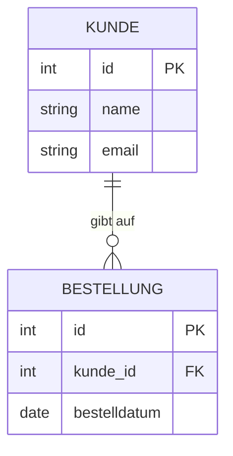
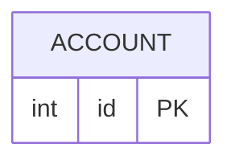

# Mein ER-Modell

Hier zeichnet ihr euer ER-Diagramm für das MMO (Schritt 2).

**Vorschau ansehen:** In VS Code mit der Erweiterung *Markdown Preview Mermaid Support* die Datei öffnen und `Strg + Umschalt + V` drücken. Alternativ den Code-Block auf https://mermaid.live einfügen. GitHub und GitLab zeigen das Diagramm direkt an.

## Syntax-Beispiel (anderes Thema!)

So sieht ein ER-Diagramm in Mermaid aus, hier am Beispiel eines Online-Shops:



## Kardinalitäten

Jede Seite einer Linie hat zwei Zeichen: das äußere sagt „höchstens“, das innere „mindestens“.

```text
||--||   genau eins     zu  genau eins
||--o{   genau eins     zu  keins oder viele
||--|{   genau eins     zu  eins oder viele
}o--o{   keins oder viele  zu  keins oder viele
```

Zusammengesetzter Primärschlüssel: Schreibt hinter **jede** beteiligte Spalte `PK`, bei Fremdschlüsseln `PK, FK`.

## Mein Diagramm


