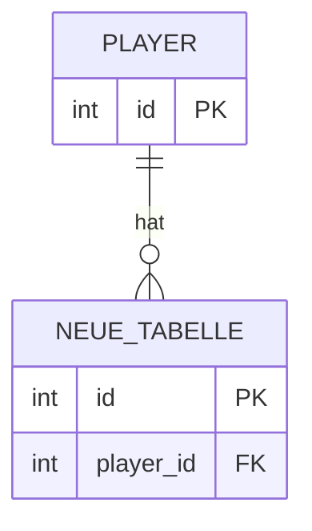

# Meine Erweiterung: _Name des Features_

**Team:** ...  
**Abgesprochen mit:** ... am ...

## 1. Idee

### Das Feature in zwei Sätzen

...

### Warum ist das ein realistischer Anwendungsfall?

Wo gibt es so etwas in echter Software, auch außerhalb von Spielen?

...

### User Stories

| Als ... | möchte ich ... | damit ... |
|---------|----------------|-----------|
| Spieler*in | ... | ... |
| ... | ... | ... |
| ... | ... | ... |

### Fachfragen

Diese Fragen muss die Datenbank beantworten können. Die SQL-Lösungen stehen im Notebook.

1. ...
2. ...
3. ...
4. ...
5. ...

## 2. Modell

### ER-Diagramm

Nur die **neuen** Tabellen und die bestehenden, an die sie angebunden sind. Bestehende Tabellen nur mit Primärschlüssel. Vorschau: `Strg + Umschalt + V`.

### Entscheidungen

Überall, wo es mehr als eine sinnvolle Lösung gab:

| Frage | Unsere Lösung | Alternative | Warum so? |
|-------|---------------|-------------|-----------|
| ... | ... | ... | ... |

### Normalform-Check

| Tabelle | Primärschlüssel | 1NF | 2NF | 3NF | Bemerkung |
|---------|-----------------|-----|-----|-----|-----------|
| ... | ... | ✓ | ✓ | ✓ | |

Kann bei euch eine Änderungs-, Einfüge- oder Löschanomalie auftreten? Wenn ja, wo, und warum nehmt ihr das in Kauf?

...

## 6. Betrieb

### Eingesetzte Werkzeuge

| Werkzeug | Wo | Warum |
|----------|----|-------|
| ... | ... | ... |

### Datenschutz

| Neue Daten | Personenbezogen? | Was passiert beim Löschen eines Accounts? |
|------------|------------------|-------------------------------------------|
| ... | ja / nein | gelöscht / anonymisiert / bleibt, weil ... |

## 7. Review

### Feedback vom anderen Team

| Gut | Frage oder Vorschlag | Umgesetzt? |
|-----|----------------------|------------|
| ... | ... | ... |
