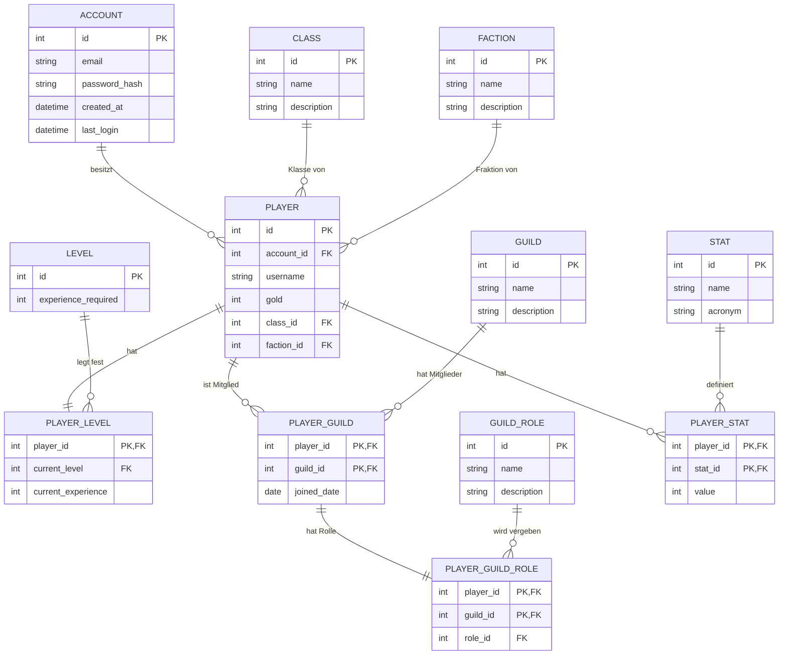

# Referenz: Musterlösung der MMO-Datenbank

> **Stopp!** Erst öffnen, wenn euer eigener Entwurf aus [Teil 2](../2-datenbank-entwerfen/Anforderungen.md) fertig ist und ihr ihn vorgestellt habt.

Diese Lösung ist **eine** mögliche Umsetzung der Anforderungen, aber nicht die einzig richtige. Vergleicht sie mit eurem Modell und überlegt bei jedem Unterschied, welche Variante besser zu den Anforderungen passt.

## Inhalt

| Datei | Beschreibung |
|-------|--------------|
| `setup.sql` | Legt alle Tabellen an und füllt sie mit Testdaten: 5.000 Accounts, 15.000 Charaktere, 6 Gilden. Wird in [Teil 3](../3-abfragen/abfragen.ipynb), Teil 4 und Teil 5 geladen. |

Hinweise zu `setup.sql`:

- Die Daten sehen zufällig aus, sind aber **bei jedem Ausführen gleich**. Deshalb passen die Kontrollwerte in Teil 3.
- Das Skript ist für eine **frische, leere** Datenbank gedacht.
- `password_hash` enthält nur einen Platzhalter, keinen echten Hash.

## Namen

Tabellen und Spalten sind englisch benannt, wie es in der Softwareentwicklung üblich ist.

| Tabelle | Bedeutung |
|---------|-----------|
| `account` | Account |
| `player` | Charakter |
| `class` | Klasse |
| `faction` | Fraktion |
| `stat` / `player_stat` | Werte / Werte eines Charakters |
| `level` / `player_level` | Level / aktuelles Level eines Charakters |
| `guild` / `player_guild` | Gilde / Mitgliedschaft |
| `guild_role` / `player_guild_role` | Rolle / Rolle eines Mitglieds in einer Gilde |

## ER-Diagramm

Im Diagramm steht `CLASS` in Anführungszeichen, weil `CLASS` in Mermaid ein reserviertes Wort ist.

## Wie die Anforderungen umgesetzt sind

| Anforderung | Umsetzung |
|-------------|-----------|
| E-Mail nur einmal | `email TEXT NOT NULL UNIQUE` |
| kein negatives Gold, Start bei 0 | `gold INTEGER NOT NULL DEFAULT 0 CHECK (gold >= 0)` |
| Account löschen löscht alles | `ON DELETE CASCADE` von `account` über `player` bis zu Werten, Level und Mitgliedschaften |
| neue Klassen, Fraktionen, Werte ohne neue Spalten | eigene Tabellen `class`, `faction`, `stat` |
| mehrere Gilden pro Charakter | Zwischentabelle `player_guild` mit zusammengesetztem Primärschlüssel |
| genau eine Rolle pro Mitgliedschaft | `player_guild_role` hat denselben Primärschlüssel wie `player_guild` |

## Diskussionsfragen

- Level und Erfahrung liegen in einer eigenen Tabelle `player_level` (1:1 zu `player`). Wäre es auch als Spalten in `player` gegangen? Vor- und Nachteile?
- Die Rolle hängt an der Mitgliedschaft (`player_guild_role` → `player_guild`), nicht am Charakter. Warum?
- `player_guild_role` könnte man auch weglassen und `role_id` direkt in `player_guild` speichern. Was spricht dafür, was dagegen?
- Was passiert, wenn eine Gilde gelöscht wird? Ist das so gewollt?
